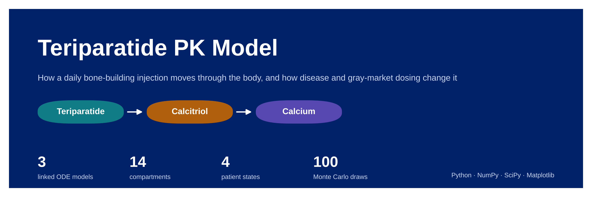
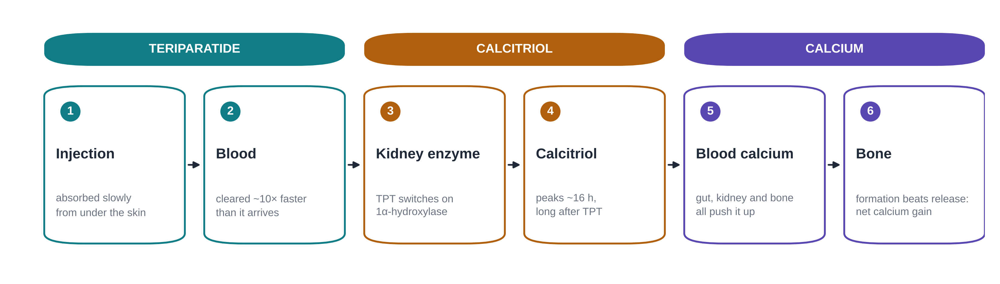
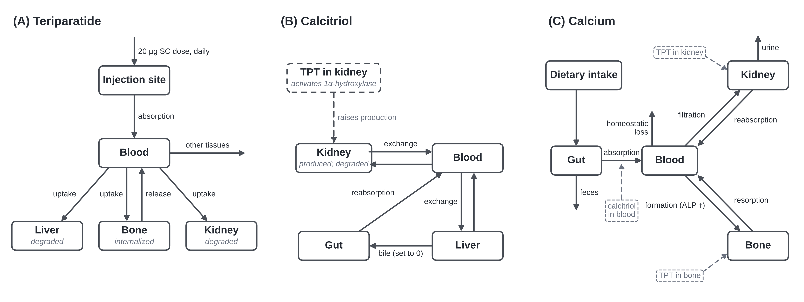
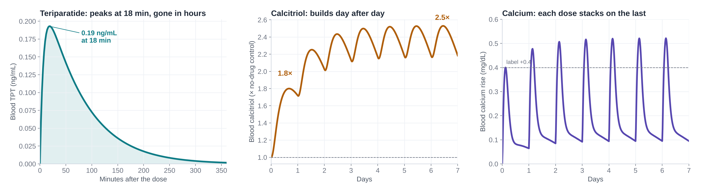
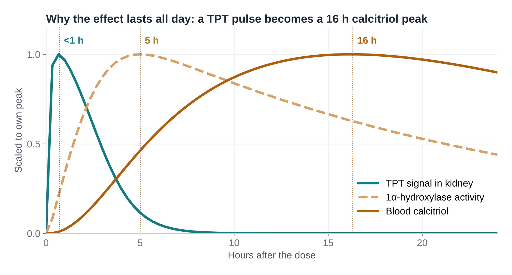
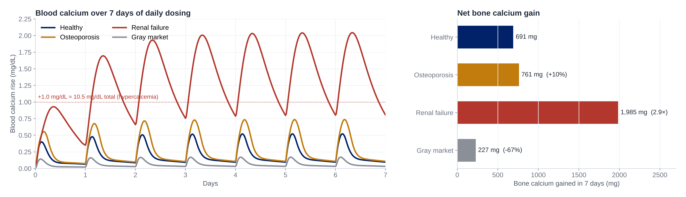
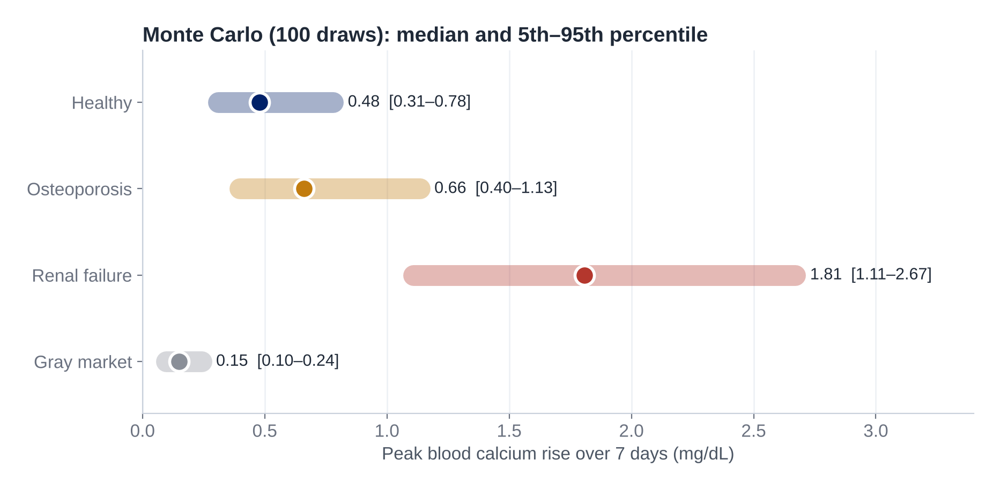

A linked compartment model of **teriparatide** (TPT, PTH 1–34), **calcitriol** and **calcium** in the human body, built in Python for Duke BME 260L. It follows a daily 20 µg injection from under the skin to the kidney, into active vitamin D, and out to blood and bone calcium over 7 days, then asks how osteoporosis, renal failure and gray-market dosing change that response.

## Research question

> How does teriparatide moving through the kidney and bone drive bone formation, and how do disease states and gray-market dosing errors change that response?

## How the model works



Three mass-balance ODE models are solved in sequence. Each compartment follows

$$\frac{dm}{dt} = \sum \dot m_{in} - \sum \dot m_{out} + \dot m_{gen} - \dot m_{cons}$$

with first-order transport between compartments. The drug acts by changing downstream rate constants: TPT in the kidney switches on calcitriol production and boosts calcium reabsorption, TPT in bone raises calcium release, calcitriol raises gut absorption, and the calcium rise drives bone formation through ALP.



## Results

### One dose a day: the effect builds



| | Day 1 | Day 7 |
|---|---|---|
| Peak blood TPT | 0.19 ng/mL at 18 min | same each dose |
| Peak calcitriol | 1.8× control at 16 h | 2.5× control |
| Peak blood calcium rise | +0.40 mg/dL at 3 h | +0.52 mg/dL |
| Bone calcium gained | 59 mg | 691 mg total |

### Why the effect lasts all day

TPT is cleared within hours, but it switches on a slow kidney enzyme. That delay turns a short drug pulse into a calcitriol peak 16 hours later, so each daily dose builds on the last.



### Patient state changes everything



| State | What changes in the model | Result |
|---|---|---|
| Healthy | Reference parameters | +0.40 mg/dL calcium, 691 mg bone gain |
| Osteoporosis | Slower TPT clearance, less responsive gut, smaller bone pool | Bigger, later response; 10% more bone gain |
| Renal failure | Kidney clears less TPT and makes less calcitriol | Doses stack toward hypercalcemia (~11.5 mg/dL by day 7) |
| Gray market | ~0.15× the labeled dose of active drug | One-third of the bone gain, little benefit |

### Uncertainty: Monte Carlo

Every uncertain parameter was re-drawn 100 times from its literature range, using the same draws in every state. The healthy and renal-failure ranges never overlap, so **patient state matters more than parameter uncertainty**.



## Run it

```bash
pip install numpy scipy matplotlib
python main.py
```

| File | Contents |
|---|---|
| `main.py` | Model equations, patient states, calibration, Monte Carlo, plotting |
| `tpt.py`, `calcitriol.py`, `calcium.py` | Parameters for each model |
| `figures/` | Output figures for every patient state |

Settings at the top of `main.py`: `SIM_DAYS` (7), `RUN_MONTE_CARLO` (True), `N_RUNS` (100), `RUN_HYDROXYLASE_SWEEP` (True), `FIGURE_FORMAT` ("png" or "pdf").

## Methods at a glance

- Solved with `scipy.integrate.solve_ivp` (LSODA); mass conservation checked numerically for all three models
- Calibrated once on the healthy state (calcitriol +80%, calcium +0.4 mg/dL from the FDA label), then held fixed
- Results reported as treated minus a no-drug control
- Structural sensitivity test on the unmeasured enzyme half-life (8–24 h)

## Limitations

- Renal failure keeps healthy calcium filtration, so its calcium rise is likely an overestimate
- Bone formation responds instantly to blood calcium; there are no bone-cell dynamics
- Some route fractions come from rat and dog organ studies
- Gray-market potency is based on semaglutide product testing, not teriparatide

## Team

Robert Barsel · Charlie Hanby · Chukwudumaga Iloh · Jake Golden · Alisha Gupta · Camryn Pivarnik · Monona Zhou
Duke University, BME 260L, Fall 2026
