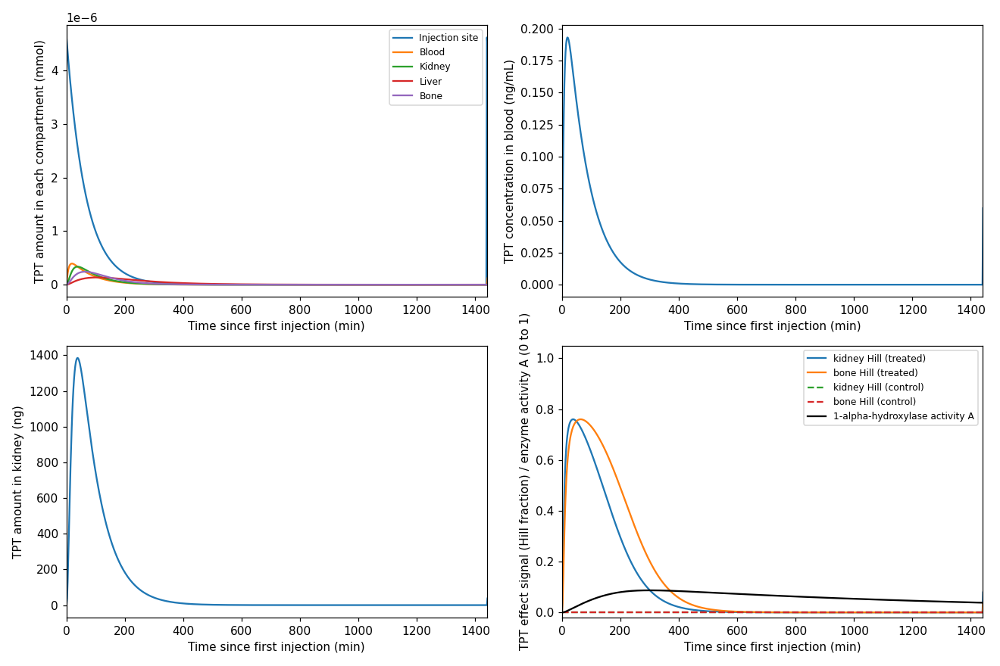
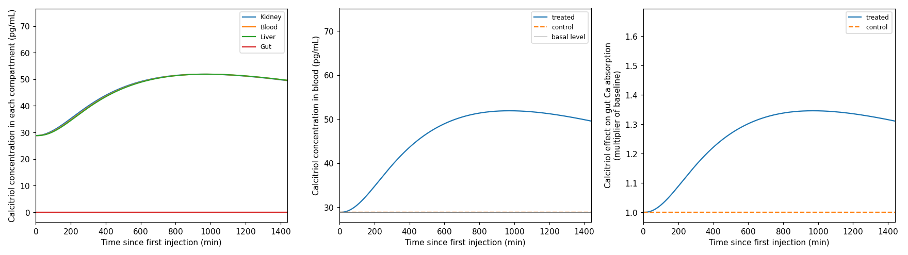
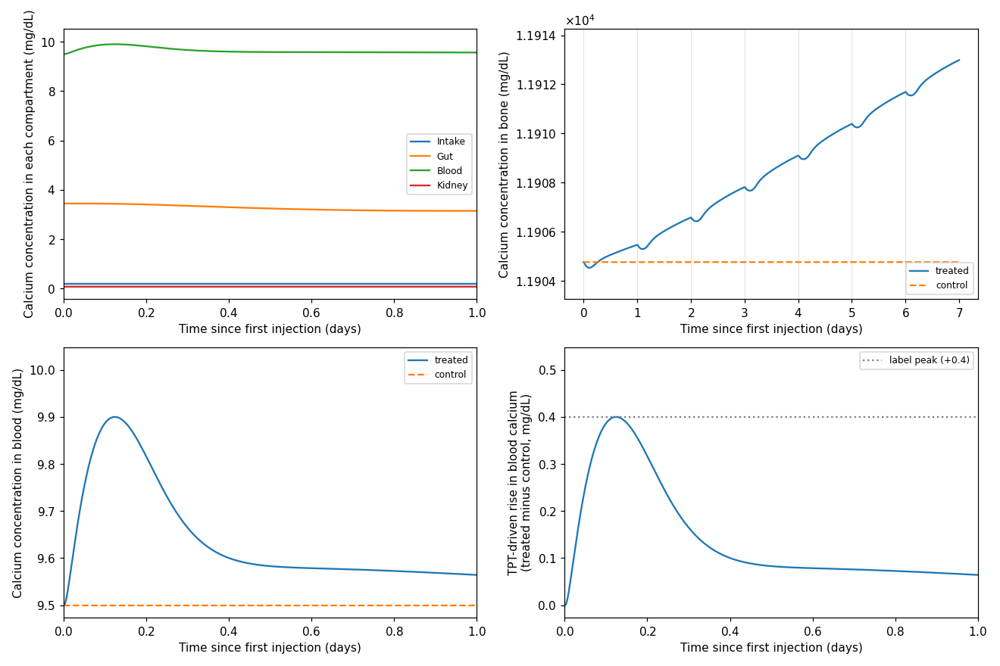
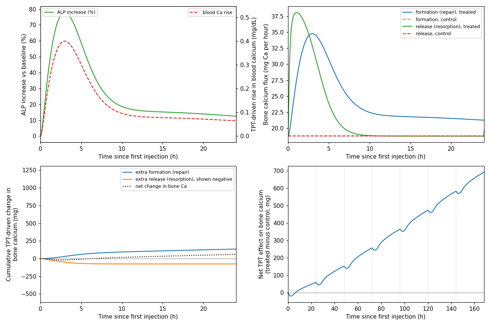
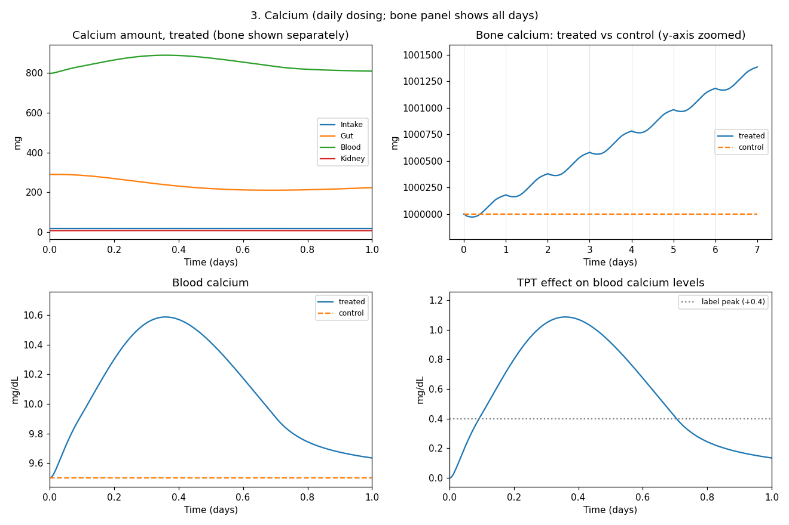
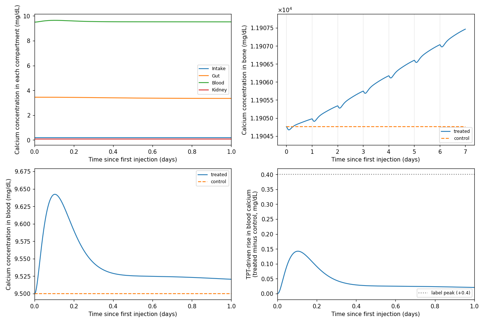
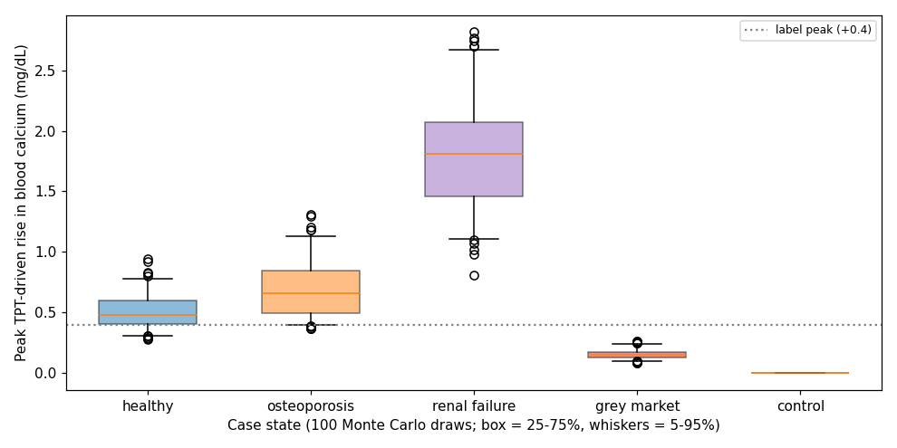
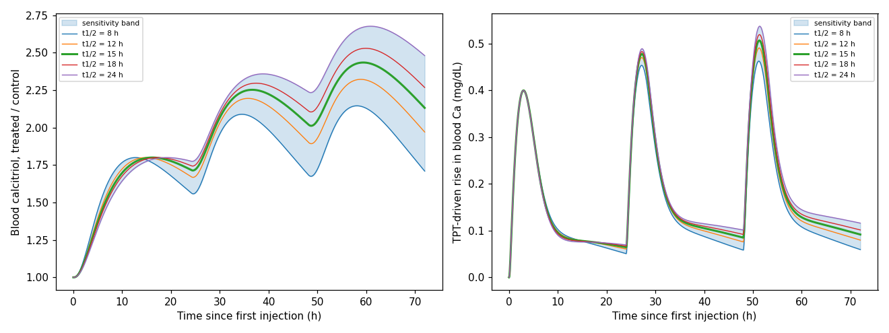

# Modelling Teriparatide-Driven Effects on Bone Growth and Alterations from Disease State and Gray-Market Dosing

A linked compartment model of **teriparatide** (TPT, PTH 1–34), **calcitriol** and **calcium** in the human body, built in Python for Duke BME 260L (Problem-Based Learning 1).

The model follows a daily 20 µg subcutaneous injection from under the skin through the kidney and bone, into active vitamin D (calcitriol), and out to blood and bone calcium over 7 days. It then asks how osteoporosis, renal failure and gray-market dosing errors change that response.

**Research question:** How does teriparatide pharmacokinetics in the kidney and bone change bone growth, and how do disease states and gray-market dosing errors alter this behavior?

## Model

Three mass-balance ODE models are solved in sequence. Every compartment follows

$$\frac{dm}{dt} = \sum \dot m_{in} - \sum \dot m_{out} + \dot m_{gen} - \dot m_{cons}$$

with first-order transport between compartments.

| Model | Compartments | Driven by |
|---|---|---|
| Teriparatide (mmol) | injection site, blood, kidney, liver, bone | daily SC dose |
| Calcitriol (mg) | kidney, blood, liver, gut | TPT in the kidney, through the enzyme 1α-hydroxylase |
| Calcium (mg) | dietary intake, gut, blood, kidney, bone | TPT in kidney and bone; calcitriol in blood |

The drug acts by changing downstream rate constants:

- TPT in the kidney switches on calcitriol production and increases calcium reabsorption
- TPT in bone increases calcium release
- Calcitriol in blood increases gut calcium absorption
- A rise in blood calcium increases bone formation (through ALP)

Every run is solved with and without the dose, and results are reported as treated minus a no-drug control.

## Patient states

| State | What changes |
|---|---|
| Healthy | Reference parameters |
| Osteoporosis | Lower calcitriol sensitivity, 15.6% less bone calcium, slower TPT clearance |
| Renal failure | Less kidney TPT uptake, slower TPT absorption and clearance, less calcitriol production, longer calcitriol half-life |
| Gray market | About 0.15× the labeled dose of active drug (users take more than labeled, but the product is low purity) |
| Control | Healthy with no TPT; confirms every drug effect is zero |

## Results

### Healthy state, 20 µg daily

| Output | Day 1 | Day 7 |
|---|---|---|
| Peak blood TPT | 0.19 ng/mL at 18 min | same each dose |
| Peak calcitriol | 1.8× control at 16 h | 2.5× control |
| Peak blood calcium rise | +0.40 mg/dL at 3 h | +0.52 mg/dL |
| Bone calcium gained | 59 mg | 691 mg total |

**Teriparatide.** TPT is absorbed slowly from the injection site and cleared quickly, so it peaks in blood at 18 minutes and is gone within a few hours. The bottom-right panel shows the TPT signal in kidney and bone and the much slower 1α-hydroxylase activity.



**Calcitriol.** Because TPT works through the slow enzyme, calcitriol keeps rising after TPT is gone and peaks about 16 hours after the dose, increasing gut calcium absorption by up to about 35%.



**Calcium.** Blood calcium rises +0.4 mg/dL about 3 hours after the dose, matching the FDA label, and bone calcium climbs over the week.



**Bone.** The calcium rise raises ALP, so bone formation outpaces release. Each dose causes a brief dip, then a net gain that builds every day.



### Comparing patient states

| State | First-dose Ca rise | Day-7 Ca rise | 7-day bone gain |
|---|---|---|---|
| Healthy | +0.40 mg/dL at 3.0 h | +0.52 mg/dL | 691 mg |
| Osteoporosis | +0.56 mg/dL at 4.1 h | +0.74 mg/dL | 761 mg (+10%) |
| Renal failure | +0.93 mg/dL at 8.7 h | +2.04 mg/dL | 1986 mg (2.9×) |
| Gray market | +0.14 mg/dL at 2.5 h | +0.17 mg/dL | 227 mg (−67%) |

In renal failure, TPT and calcitriol linger, so each dose builds on the last and blood calcium approaches the hypercalcemia range (about 11.5 mg/dL by day 7).



The gray-market product gives about a third of the healthy calcium and bone response.



Figures for every state are in [`figures/`](figures).

### Monte Carlo uncertainty

Every uncertain parameter was re-drawn 100 times from its literature range, using the same draws in every state.

| State | Peak Ca rise, median [5th–95th] (mg/dL) |
|---|---|
| Healthy | 0.48 [0.31–0.78] |
| Osteoporosis | 0.66 [0.40–1.13] |
| Renal failure | 1.81 [1.11–2.67] |
| Gray market | 0.15 [0.10–0.24] |

The healthy and renal-failure ranges do not overlap, so **patient state matters more than parameter uncertainty**.



### Enzyme half-life sensitivity

The 1α-hydroxylase half-life has not been measured, so the healthy state is re-run from 8 to 24 hours, recalibrating each time. It shifts calcitriol timing but barely changes the calcium response.



## Running the model

Requirements: Python 3, NumPy, SciPy, Matplotlib.

```bash
pip install numpy scipy matplotlib
python main.py
```

| File | Contents |
|---|---|
| `main.py` | Model equations, patient states, calibration, Monte Carlo, plotting |
| `tpt.py` | Teriparatide parameters |
| `calcitriol.py` | Calcitriol parameters |
| `calcium.py` | Calcium parameters |
| `figures/` | Output figures for every patient state |

Settings near the top of `main.py`:

| Setting | Default | Purpose |
|---|---|---|
| `SIM_DAYS` | 7 | Simulated days (one dose per day) |
| `RUN_MONTE_CARLO` | True | Run the Monte Carlo analysis |
| `N_RUNS` | 100 | Monte Carlo draws per state |
| `RUN_HYDROXYLASE_SWEEP` | True | Enzyme half-life sensitivity test (8–24 h) |
| `FIGURE_FORMAT` | "png" | "png" for individual figures, "pdf" for one PDF per state |

## Methods notes

- Solved with `scipy.integrate.solve_ivp` (LSODA); mass conservation is checked numerically for all three models
- Three quantities without direct measurements are calibrated once on the healthy state and held fixed: TPT-driven calcitriol production (to an 80% rise), the calcium effect scale (to the +0.4 mg/dL label rise), and the Hill half-saturation constants
- Results are reported as treated minus a no-drug control

## Limitations

- Renal failure keeps healthy calcium filtration, so its calcium rise is likely an overestimate
- Bone formation responds instantly to blood calcium; there are no bone-cell dynamics
- Some route fractions come from rat and dog organ studies
- Gray-market potency is based on semaglutide product testing, not teriparatide

## Team

Robert Barsel, Charlie Hanby, Chukwudumaga Iloh, Jake Golden, Alisha Gupta, Camryn Pivarnik, Monona Zhou

Duke University, BME 260L, Fall 2026
